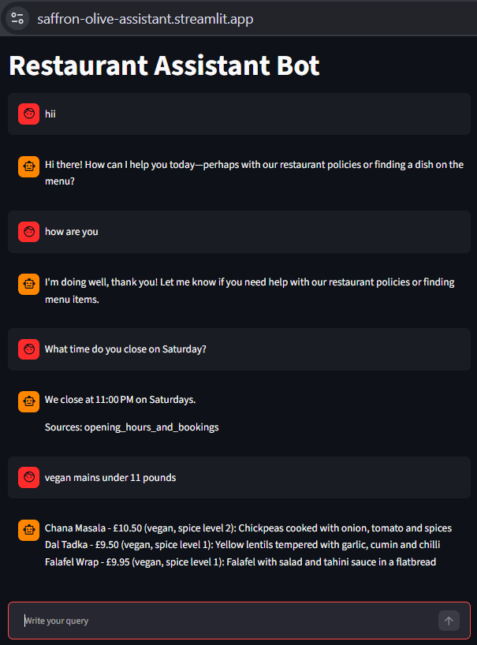

# Saffron & Olive Assistant: RAG + Text-to-SQL Restaurant Chatbot

A chatbot for a restaurant that answers two kinds of customer questions:

- **Policy questions** ("What time do you close on Saturday?", "Is your chicken halal?") answered with **RAG** over the restaurant's policy documents, stored in ChromaDB
- **Menu questions** ("Vegan mains under £11", "Anything with spinach?") answered by having an LLM **write SQL** for a SQLite menu database and turning the matching dishes into a readable reply

A **semantic router** sends each question to the right pipeline using embedding similarity, and greetings go to a separate small-talk handler.

**Live demo:** [Open the app on Streamlit Cloud](https://saffron-olive-assistant.streamlit.app)

<p align="center">
  
</p>

## How it works

```
Customer question
      │
      ▼
Semantic router (sentence-transformers embeddings)
      │
      ├── policy ──► ChromaDB similarity search ──► keep chunks below a distance threshold
      │                 ──► Groq LLM answers from those chunks only ──► answer + sources
      │
      ├── menu ──► Groq LLM writes SQL (<SQL> tags) ──► SQLite menu table
      │                 ──► Groq LLM turns the matching dishes into a reply
      │
      └── small_talk ──► Groq LLM replies briefly and explains what it can help with
```

## Tech stack

- **LLM:** Groq API (`openai/gpt-oss-120b`)
- **Vector database:** ChromaDB (persistent)
- **Embeddings:** `sentence-transformers/all-MiniLM-L6-v2`
- **Chunking:** LangChain `RecursiveCharacterTextSplitter`
- **Routing:** semantic-router (`IndexedRouter`)
- **Database:** SQLite + pandas
- **UI:** Streamlit chat interface

## Key features

- **RAG over policy documents:** five policy files (opening hours and bookings, allergens and dietary, delivery and takeaway, refunds and complaints, loyalty and offers) are split into chunks, embedded and stored in ChromaDB. Ingestion runs only once; later starts reuse the stored vectors.
- **Relevance filtering:** only chunks within a distance threshold are sent to the LLM. If nothing is relevant, the app replies "I don't know" straight away, without calling the LLM.
- **Grounded answers with sources:** the LLM is instructed to answer only from the retrieved text, and the sources shown come from the stored metadata, not from the LLM's own text.
- **Text-to-SQL over the menu:** the menu CSV is loaded into SQLite. A schema prompt describes every column and maps everyday words to SQL (for example "spicy" means `spice_level >= 2` and "mains" means `category = 'main'`). Ingredient searches check both dish names and descriptions.
- **Safe queries:** only `SELECT` queries are executed, results are limited, and questions that are not about the menu return no SQL at all.
- **Semantic routing:** each question is compared with example questions for the `policy`, `menu` and `small_talk` routes, so no extra LLM call is needed to decide where it goes.
- **Chat interface:** a Streamlit chat UI that keeps the conversation on screen using session state.

## Project structure

```
app/
├── main.py          # Streamlit chat UI and routing logic
├── router.py        # semantic routes and example questions
├── rag.py           # policy ingestion into ChromaDB + RAG answer chain
├── sql.py           # menu database, text-to-SQL and answer chain
├── small_talk.py    # replies for greetings and general chat
└── data/
    ├── menu.csv     # 35 dishes with price, diet, spice level, allergens
    └── policies/    # 5 policy documents
```

## Run it locally

1. Clone the repo, create a Python 3.11 virtual environment and install the requirements:
   ```
   python -m venv venv
   venv\Scripts\activate        # Windows (macOS/Linux: source venv/bin/activate)
   pip install -r requirements.txt
   ```
2. Create a `.env` file in the project folder:
   ```
   GROQ_API_KEY=your_key_here
   GROQ_MODEL=openai/gpt-oss-120b
   ```
3. Start the app from the project folder:
   ```
   streamlit run app/main.py
   ```
   On the first run, the policies are ingested into ChromaDB and the menu database is created automatically.

## Example questions

| Route | Question |
|---|---|
| Policy | What time do you close on Saturday? |
| Policy | Is your chicken halal? |
| Policy | Do students get a discount on Friday? |
| Menu | Vegan mains under 11 pounds |
| Menu | Anything with spinach? |
| Menu | Desserts without nuts |
| Small talk | Hi, what can you help me with? |

## Next steps

- Turn the router into an AI agent that can use both tools for mixed questions, such as "Is the baklava nut free?", which needs the menu (the dish contains walnuts) and the allergen policy (cross-contamination risk)
- Add conversation memory so follow-up questions work
- Add an evaluation set to measure routing and answer accuracy

## Data

Saffron & Olive is a fictional restaurant. The menu, prices and policies were made up for this project.
